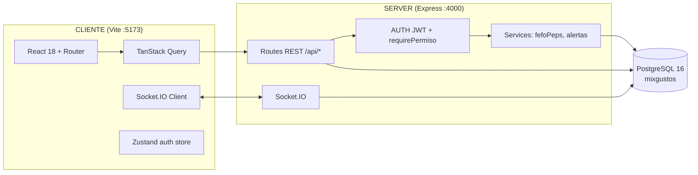
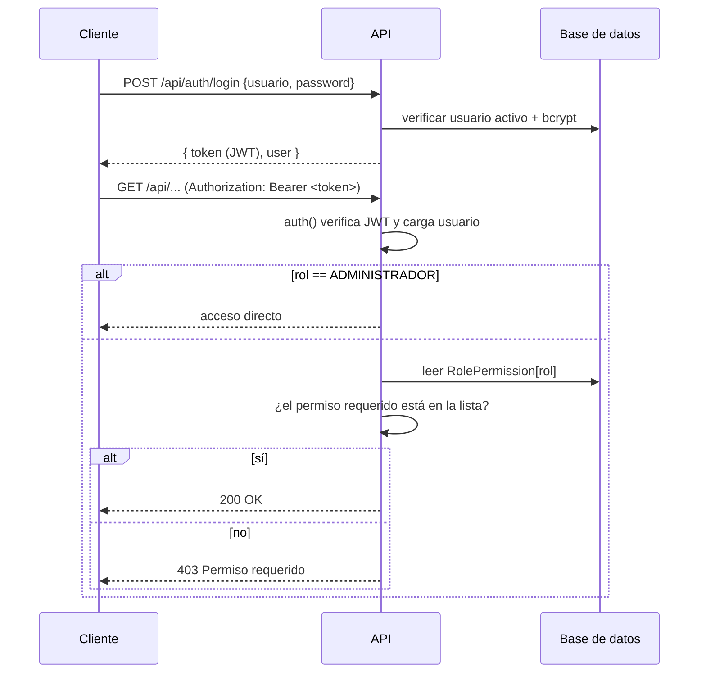
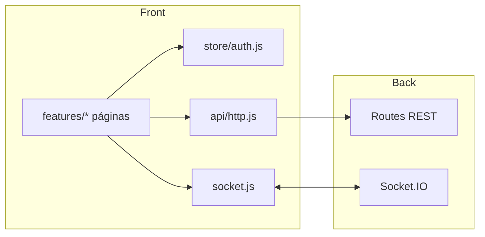

# Arquitectura

MixGustos es un monorepo de **dos workspaces npm** (`server` y `client`) con una API REST + Socket.IO y un SPA en React. La persistencia corre en PostgreSQL dentro de Docker, gestionada con Prisma.

## Vista general

- El navegador habla con la API a través del proxy de Vite (`/api` y `/socket.io` → `http://localhost:4000`).
- El servidor valida cada request con JWT y, cuando aplica, con permisos por rol.
- Los eventos de tiempo real (pedidos, alertas, consumos) se emiten por Socket.IO agrupando sockets por `rol:*` y por `user:*`.

## Backend (server)

Entrada: `src/index.js` (Express + HTTP + Socket.IO). Estructura:

| Ruta | Responsabilidad |
|---|---|
| `src/config/index.js` | Lee `.env` (puerto, JWT secret, CORS, DATABASE_URL) |
| `src/lib/prisma.js` | Cliente Prisma compartido |
| `src/lib/http.js` | Helper de respuesta HTTP |
| `src/lib/permisos.js` | Catálogo de permisos por rol |
| `src/middleware/auth.js` | `auth` (JWT), `requireRol(...roles)`, `requirePermiso(...)` |
| `src/middleware/error.js` | 404 y manejador global de errores |
| `src/routes/*.routes.js` | 13 módulos de API |
| `src/services/fefoPeps.js` | Motor de selección de lotes FEFO/PEPS y consumo |
| `src/services/alertas.js` | Detección de vencidos, stock mínimo, reposición y diferencias |
| `src/socket/index.js` | Autenticación de sockets + eventos de dominio |

### Seguridad y autorización

### Eventos Socket.IO

| Evento | Origen | Destino | Cuándo |
|---|---|---|---|
| `pedido:nuevo` | API (crear pedido) | rol COCINERO | Al confirmar un pedido |
| `pedido:estado` | API (cambiar estado) | MOZO_SALON, MOZO_PUERTA, COCINERO + creador | Cada cambio de estado |
| `pedido:listo` | API (kitchen listo) | MOZOS + creador | Un plato/ítem está listo |
| `alerta:nueva` | Servicio de alertas | ALMACENERO, GERENTE, ADMIN | Se crea una alerta |
| `consumo:realizado` | Servicio fefoPeps | ALMACENERO, GERENTE | Se registra consumo de insumos |
| `auth:ok` | Servidor | socket que conecta | Confirmación de conexión autenticada |

## Frontend (client)

- **Estado**: Zustand guarda token + usuario (persistido en `localStorage`).
- **Datos**: TanStack Query para fetch/caché de la API.
- **Rutas**: `App.jsx` envuelve cada ruta en `<Protected>` (redirige a `/login` si no hay sesión) y en el layout según rol.
- **Layout**: `components/layout/AppLayout.jsx` muestra la navegación según `user.rol` (admin ve administración, mozo de salón ve mesas, etc.).
- **Carpetas por feature** en `src/features/*`: cada módulo del negocio tiene su página y su lógica.

### Comunicación

## Base de datos

La conexión va de Prisma a PostgreSQL en `localhost:5432` (contenedor `mixgustos_db`). Las migraciones están en `server/prisma/migrations` y se aplican con `npm run migrate`. El detalle del modelo está en [base-de-datos.md](base-de-datos.md).

## Decisiones de diseño

- **Monorepo con workspaces**: un solo `npm install` y scripts unificados desde la raíz.
- **Método de inventario configurable** (`FEFO` o `PEPS`): el servicio `fefoPeps.js` consume lotes en orden (vencimiento o ingreso) al marcar un ítem como listo.
- **Stock derivado de lotes**: `product.stock` no se almacena; se agrega la suma de `Lot.cantidadActual` activos.
- **Consumo al marcar "listo"**: cada `OrderItem` se descuenta una sola vez (flag `consumido`), registrando movimientos `SALIDA` y consumos teórico/real.
- **Alertas periódicas**: un `setInterval` (5 min) y un endpoint `POST /api/alerts/check` regeneran alertas (vencidos, stock mínimo, reposición, diferencias).
