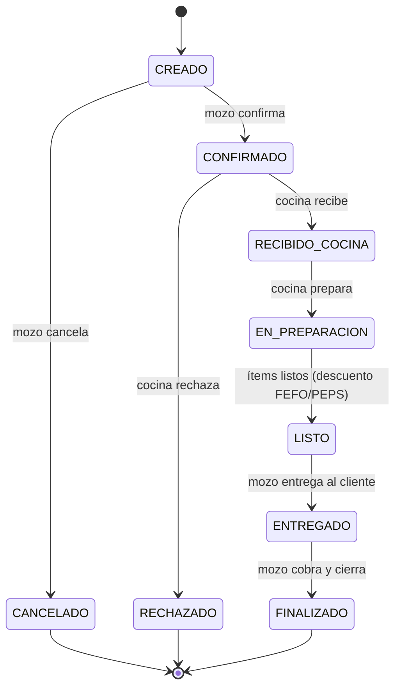
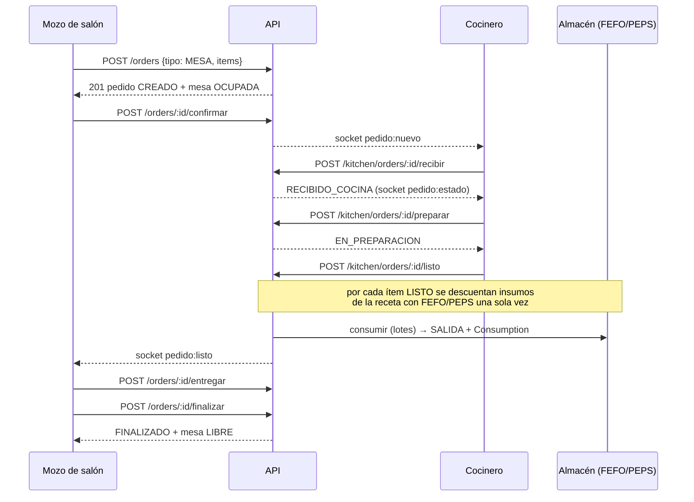
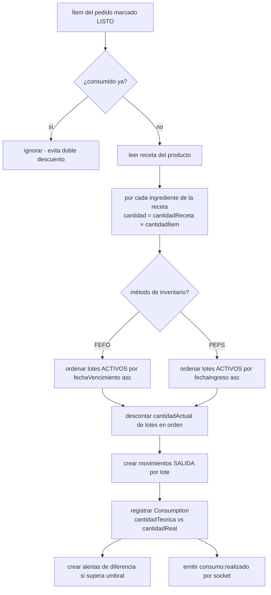
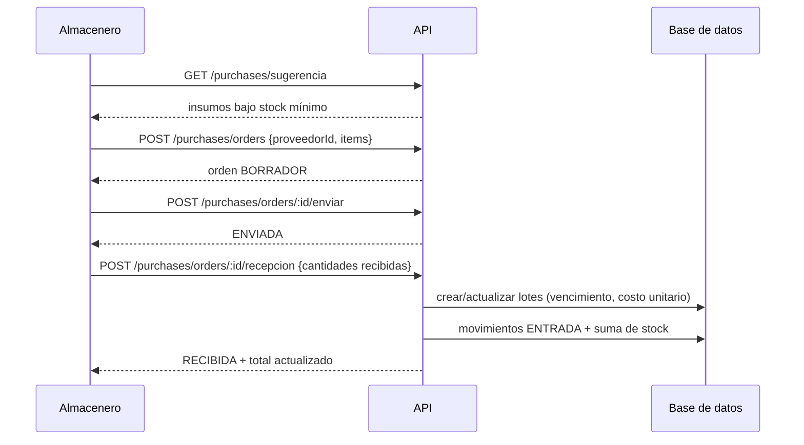
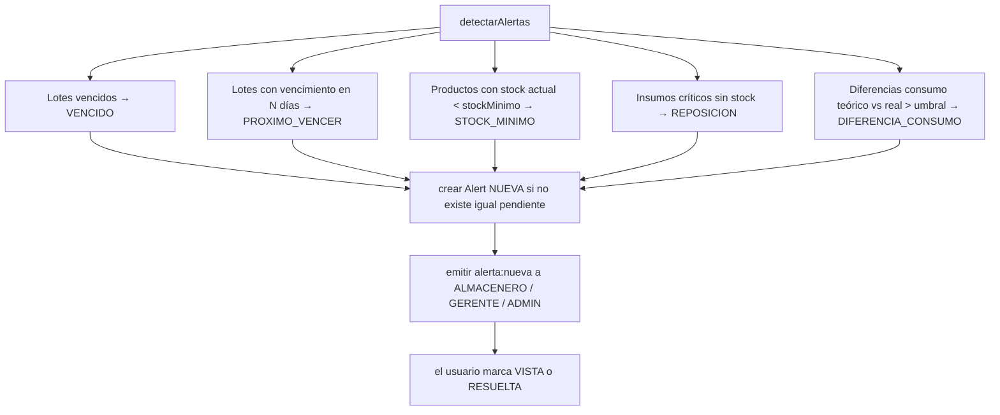
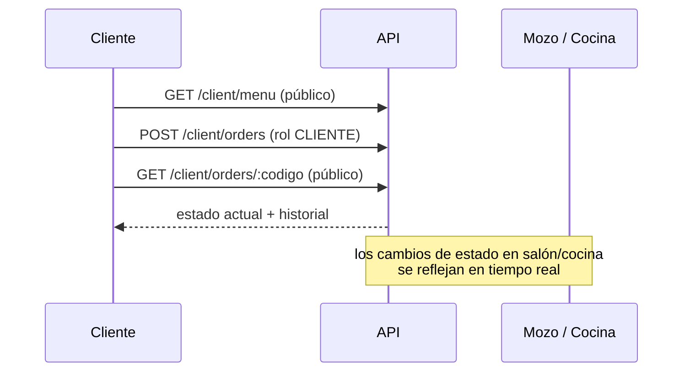

# Flujos del negocio

## 1. Ciclo de vida de un pedido

Secuencia completa (salón):

## 2. Consumo de insumos y FEFO/PEPS

Cuando un ítem se marca como **listo**, el motor `services/fefoPeps.js` descuenta el inventario según la receta del plato y el método de inventario configurado.

## 3. Compras y recepción de mercadería

## 4. Alertas automáticas

El servicio `services/alertas.js` corre cada 5 minutos (y al arrancar el servidor, o a demanda con `POST /api/alerts/check`).

## 5. Portal del cliente

